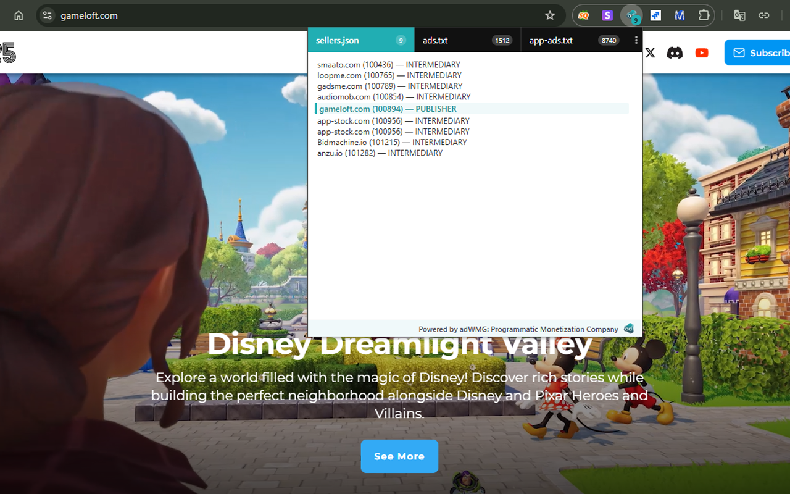
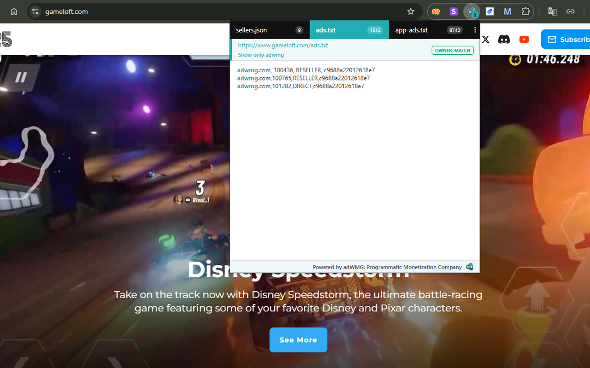
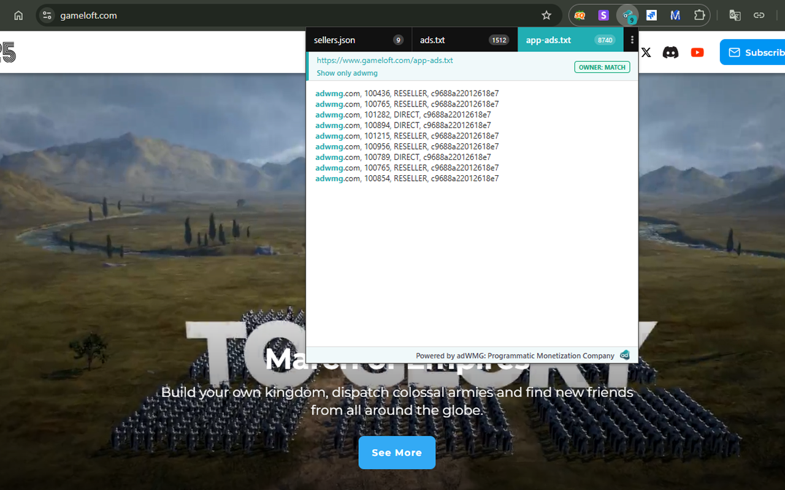
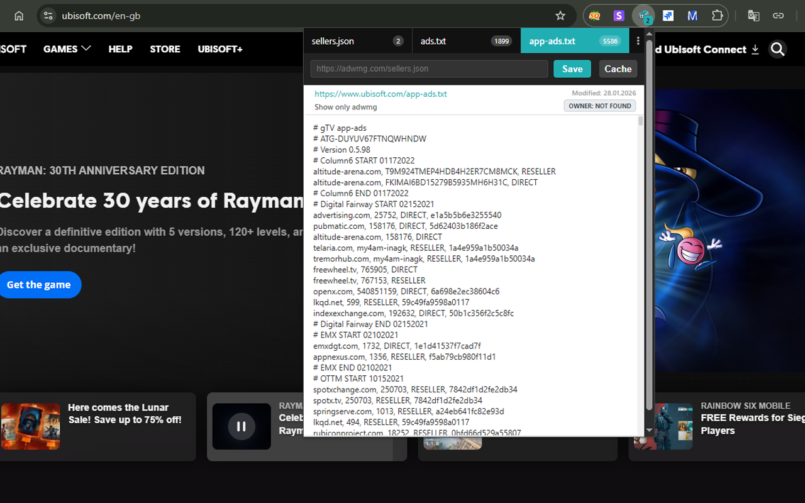
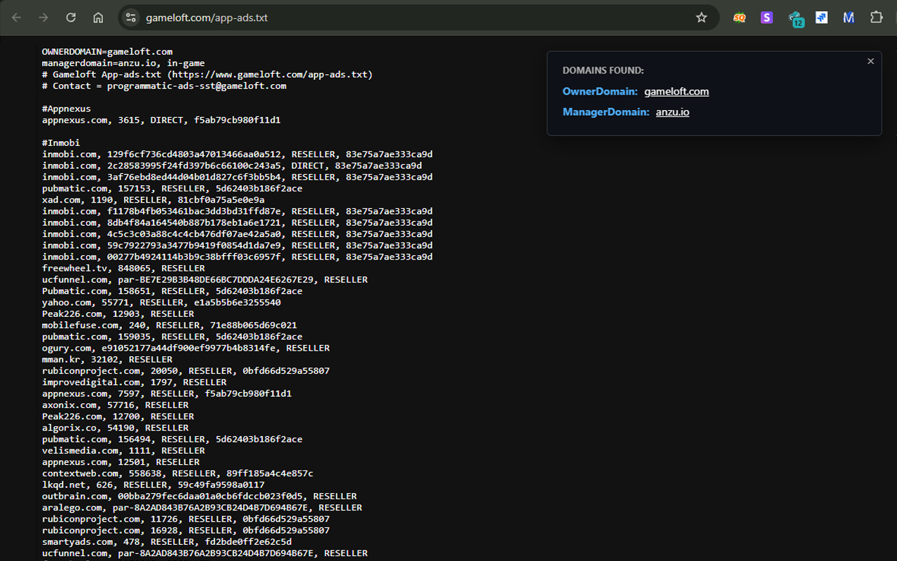

# adWMG Checker: ads.txt / sellers.json

Chrome extension (Manifest V3) that validates `ads.txt` and `app-ads.txt` files, cross-references seller IDs with `sellers.json`, detects errors, and analyzes SPO metrics.

## Screenshots

| sellers.json | ads.txt |
| --- | --- |
|  |  |

| app-ads.txt | Settings and full file |
| --- | --- |
|  |  |

## Install from source

1. Clone or download this repository.
2. Open `chrome://extensions` and enable **Developer mode**.
3. Click **Load unpacked** and select the repository folder (the one with `manifest.json`).

## Project structure

See [docs/extension-structure.md](docs/extension-structure.md) for the folder layout, asset map and packaging notes.

## License

[GNU AGPL v3.0](LICENSE)
